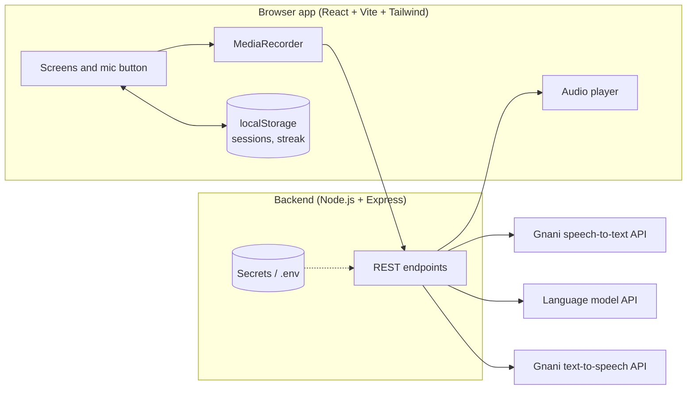
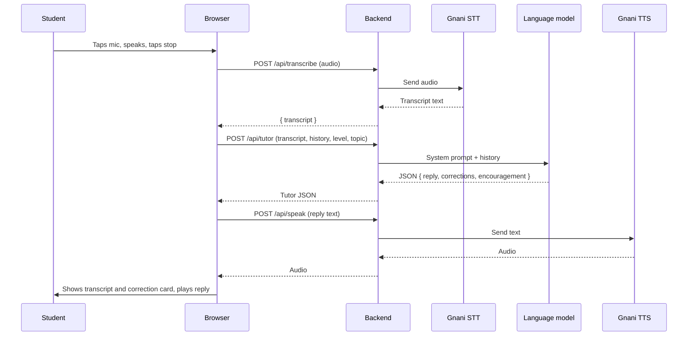
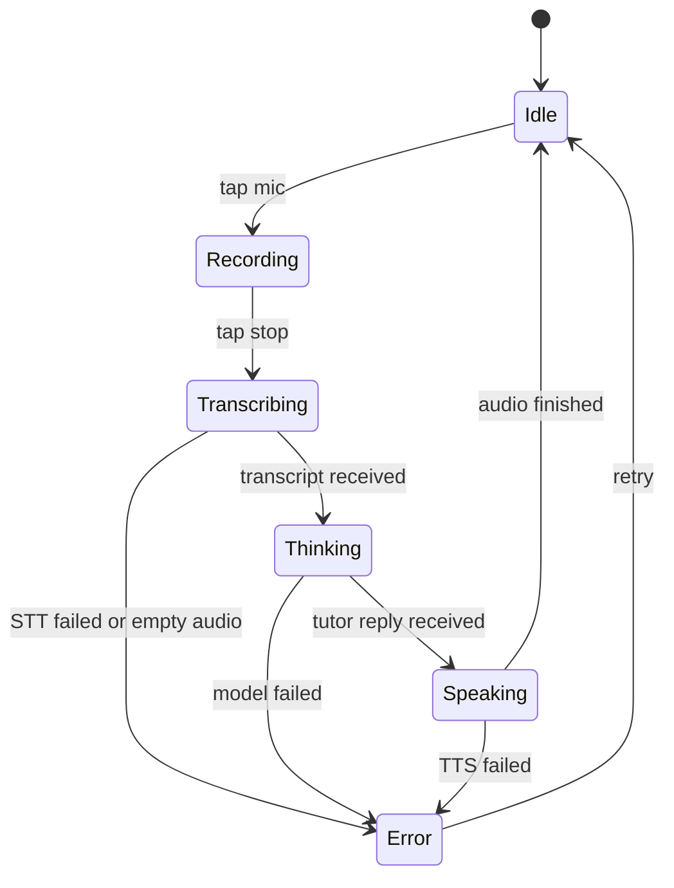

# Bol: Architecture

Bol is a voice-first web app that helps Hindi-speaking students practise spoken English. The student speaks, Bol transcribes, a tutor model replies and corrects, and Bol speaks the reply back.

Built for Gnani AI's Great Indian AI Internship Challenge (deadline: Nov 10, 2026, 11:59 PM IST).

> **Important:** Anything marked **[CONFIRM]** depends on the exact Gnani API format. Copy the real request examples and language codes from https://docs.gnani.ai before building and paste them into your vibe-coding tool. Do not let the tool guess them.

---

## 1. System overview



**Core rule:** the browser never calls Gnani or the language model directly. Only the backend holds API keys.

---

## 2. Technology stack

| Layer | Choice | Why |
| --- | --- | --- |
| Frontend | React + Vite | Fast setup, vibe tools generate it by default |
| Styling | Tailwind CSS | Quick, consistent, mobile-first design |
| Charts | Recharts | Simple progress line chart |
| Recording | Browser `MediaRecorder` API | Push-to-talk (record, stop, send) |
| Backend | Node.js + Express | Small server that hides API keys |
| Speech-to-text | Gnani speech-to-text API (Prisma) | Required by the contest; handles Hinglish and noisy audio |
| Text-to-speech | Gnani text-to-speech API (Timbre) | Required by the contest; Indian-language voices |
| Tutor brain | Hosted language model API (Claude, Gemini or OpenAI) | Gnani Evon is not on the API platform |
| Storage | Browser localStorage (small DB optional) | No login needed; keeps it simple |
| Hosting | Replit / Vercel + Render, or the vibe tool's built-in hosting | Needs a public HTTPS URL for mic access |

HTTPS is required in production because browsers only allow microphone access on secure origins (localhost is fine for development).

---

## 3. Project structure

```
bol/
├── client/                      # React frontend
│   ├── src/
│   │   ├── main.jsx
│   │   ├── App.jsx              # Router and layout
│   │   ├── pages/
│   │   │   ├── Welcome.jsx
│   │   │   ├── Setup.jsx        # Level and topic selection
│   │   │   ├── Conversation.jsx # Main voice screen
│   │   │   ├── Summary.jsx      # End-of-session scores
│   │   │   └── Progress.jsx     # History chart and streak
│   │   ├── components/
│   │   │   ├── MicButton.jsx
│   │   │   ├── Transcript.jsx
│   │   │   ├── TutorReply.jsx
│   │   │   ├── CorrectionCard.jsx
│   │   │   ├── ScoreRing.jsx
│   │   │   ├── ProgressChart.jsx
│   │   │   └── ErrorBanner.jsx
│   │   ├── hooks/
│   │   │   ├── useRecorder.js   # MediaRecorder wrapper
│   │   │   ├── useAudioPlayer.js
│   │   │   └── useSession.js    # Conversation state
│   │   ├── lib/
│   │   │   ├── api.js           # Calls to the backend
│   │   │   └── storage.js       # localStorage helpers
│   │   └── styles/
│   └── package.json
├── server/                      # Express backend
│   ├── index.js                 # App entry
│   ├── routes/
│   │   ├── transcribe.js        # POST /api/transcribe
│   │   ├── tutor.js             # POST /api/tutor
│   │   ├── speak.js             # POST /api/speak
│   │   └── summary.js           # POST /api/summary
│   ├── services/
│   │   ├── gnaniStt.js          # Gnani speech-to-text client
│   │   ├── gnaniTts.js          # Gnani text-to-speech client
│   │   └── llm.js               # Language model client
│   ├── prompts/
│   │   ├── tutorSystem.js
│   │   └── summarySystem.js
│   ├── middleware/
│   │   ├── errorHandler.js
│   │   └── rateLimit.js
│   ├── demoData/
│   │   └── demoTurns.json       # Fallback demo mode
│   └── package.json
├── .env.example
└── README.md
```

---

## 4. Environment variables

Store these in the backend's secrets (never in frontend code, never in chat, never committed to Git).

```env
GNANI_API_KEY=your_gnani_key
GNANI_STT_URL=...        # [CONFIRM] from docs.gnani.ai
GNANI_TTS_URL=...        # [CONFIRM] from docs.gnani.ai
LLM_API_KEY=your_language_model_key
LLM_MODEL=...            # e.g. the model name you choose
PORT=3001
ALLOWED_ORIGIN=https://your-frontend-url
```

Commit a `.env.example` with empty values and add `.env` to `.gitignore`.

---

## 5. Request flow for one turn



**Latency tip:** show the transcript and the correction card as soon as `/api/tutor` returns, then fetch and play audio. Students see feedback while the voice loads.

---

## 6. Backend API contract

All endpoints are JSON unless noted. Keep every response small and consistent.

### 6.1 `POST /api/transcribe`

Sends the recorded audio to Gnani speech-to-text.

- **Request:** `multipart/form-data` with an `audio` file (browser recording blob).
- **Response:**

```json
{ "transcript": "I am go to market yesterday" }
```

- **Notes:** Check Gnani docs for the accepted audio format, sample rate, and language code **[CONFIRM]**. If the browser records in `webm`, you may need to convert (for example with ffmpeg) before sending.

### 6.2 `POST /api/tutor`

Generates the tutor's reply and corrections.

- **Request:**

```json
{
  "transcript": "I am go to market yesterday",
  "history": [
    { "role": "tutor", "text": "What did you do yesterday?" }
  ],
  "level": "beginner",
  "topic": "daily_life"
}
```

- **Response:**

```json
{
  "reply": "Nice try! You went to the market. What did you buy there?",
  "corrections": [
    {
      "original": "I am go to market yesterday",
      "better": "I went to the market yesterday",
      "why": "Use past tense: went"
    }
  ],
  "encouragement": "Good effort, I understood you easily."
}
```

### 6.3 `POST /api/speak`

Turns text into spoken audio with Gnani text-to-speech.

- **Request:** `{ "text": "Nice try! ...", "voice": "default" }`
- **Response:** audio bytes (for example `audio/mpeg` or `audio/wav`, depending on Gnani **[CONFIRM]**).

### 6.4 `POST /api/summary`

Creates the end-of-session report.

- **Request:** `{ "history": [...], "level": "beginner", "topic": "daily_life" }`
- **Response:**

```json
{
  "scores": { "fluency": 6, "grammar": 5, "confidence": 7 },
  "topMistakes": [
    "Past tense verbs",
    "Missing articles (a, the)",
    "Word order in questions"
  ],
  "tip": "Practise saying what you did yesterday using went, ate and saw."
}
```

### 6.5 `GET /api/health`

Returns `{ "ok": true }`. Useful for checking the deployment.

### Error format (all endpoints)

```json
{ "error": { "code": "STT_FAILED", "message": "Couldn't hear you, try again." } }
```

Suggested codes: `EMPTY_AUDIO`, `STT_FAILED`, `LLM_FAILED`, `TTS_FAILED`, `BAD_REQUEST`, `RATE_LIMITED`.

---

## 7. Tutor prompt design

### 7.1 System prompt (tutor)

Keep it in `server/prompts/tutorSystem.js`. Core rules:

- You are a patient, friendly English speaking coach for Hindi-speaking students.
- Praise something specific first, then correct.
- Correct only the 1 or 2 most important mistakes per turn.
- Reply in at most 2 short sentences, then ask one follow-up question on the chosen topic.
- **Beginner:** simple English plus a short Hindi/Hinglish hint.
- **Intermediate:** English only, slightly richer vocabulary.
- Never be harsh or lecture. Never ask for personal details.
- Stay on the chosen topic. Keep language suitable for students.
- Return **only** valid JSON in the exact shape from section 6.2.

### 7.2 Reliability for JSON output

- Ask the model for JSON only and parse it on the backend.
- If parsing fails, retry once; if it still fails, return a safe fallback reply (for example, a simple follow-up question with no corrections).
- Validate that `corrections` is an array with at most 2 items.

### 7.3 Summary prompt

Ask for fluency, grammar and confidence (each 0 to 10), the top 3 mistakes, and one practical tip, as JSON in the shape from section 6.4.

---

## 8. Frontend design

### 8.1 Screens

| Screen | Purpose | Key elements |
| --- | --- | --- |
| Welcome | First impression | "Bol" name, tagline, Start button |
| Setup | Personalise | Level cards (Beginner / Intermediate), topic cards (Daily life / Interview / Travel) |
| Conversation | Main experience | Large mic button, live transcript, tutor reply, sliding correction card, replay button, Finish button |
| Summary | Reward and feedback | Three score rings, top 3 mistakes, one tip, Practise again button |
| Progress | Motivation | Line chart of scores, streak counter |

### 8.2 Conversation state machine



Each state drives the UI: a pulse while `Recording`, a loader while `Transcribing` and `Thinking`, a speaking animation while `Speaking`, and a friendly message with a Retry button in `Error`.

### 8.3 Design rules

- Mobile-first, works from 360 px width upward.
- Touch targets at least 44 px.
- Calm, friendly colour palette, rounded cards, readable fonts, generous spacing.
- One main action per screen.
- Corrections shown as **You said → Better → Why**, in plain words.
- Respect `prefers-reduced-motion` for animations.

### 8.4 Audio handling

- Record with `MediaRecorder`; choose a supported MIME type (for example `audio/webm`) and fall back if needed.
- Ask for microphone permission only when the student first taps the mic, with a clear explanation.
- On iOS Safari, start audio playback from a user gesture to avoid autoplay blocking.
- Stop all microphone tracks after recording to release the mic.

---

## 9. Data model (localStorage)

```json
{
  "sessions": [
    {
      "id": "2026-11-01T10:30:00Z",
      "date": "2026-11-01",
      "level": "beginner",
      "topic": "daily_life",
      "turns": [
        {
          "transcript": "I am go market",
          "reply": "Nice try! ...",
          "corrections": [
            { "original": "...", "better": "...", "why": "..." }
          ]
        }
      ],
      "scores": { "fluency": 6, "grammar": 5, "confidence": 7 },
      "topMistakes": ["..."],
      "tip": "..."
    }
  ],
  "progress": {
    "streak": 3,
    "lastPracticeDate": "2026-11-01"
  }
}
```

**Streak rule:** if the last practice date is yesterday, increase the streak; if it is today, keep it; otherwise reset to 1.

Wrap every localStorage read and write in `try/catch` so the app still works if storage is blocked.

---

## 10. Error handling and resilience

| Failure | What the student sees | What the app does |
| --- | --- | --- |
| Mic permission denied | "Please allow microphone access" | Show steps to enable it, keep Retry |
| Empty or too-short audio | "Couldn't hear you, try again" | Do not call the API, return to Idle |
| Speech-to-text fails | "Couldn't hear you, try again" | Keep conversation, allow Retry |
| Language model fails | "Bol is thinking too slowly, try again" | Retry once, then show Retry button |
| Text-to-speech fails | Reply shown as text only | Show text, offer a replay attempt |
| Slow network | Loading state with timeout | Cancel after about 20 seconds, show Retry |
| Gnani credits exhausted | "Demo mode on" | Switch to demo mode |

**Demo mode:** a small set of pre-written turns in `demoData/demoTurns.json` so the app can still be demonstrated if an API fails. Clearly label it as demo mode in the UI.

---

## 11. Security and privacy

- Keep all API keys in backend secrets. Never expose them in frontend code, browser requests, logs, screenshots or chat.
- Enable CORS only for your frontend origin.
- Add basic rate limiting (for example, a few requests per second per IP) to protect your Gnani credits.
- Limit audio upload size and length (for example, about 30 seconds per turn).
- Do not store audio on the server; process it in memory and discard it.
- Use synthetic or made-up data only. Do not record real phone numbers, Aadhaar, PAN, account numbers or other people's calls.
- Add a short privacy note in the app: audio is used only to generate the reply.

---

## 12. Performance and credits

- Target: tutor audio starts within about 6 seconds of the student stopping.
- Keep tutor replies to 2 sentences to speed up both the model and text-to-speech.
- Show the transcript and corrections before the audio arrives.
- You have 5,000 programme credits. Test with short sentences, avoid loops that re-send audio, and track usage on the Gnani dashboard (app.gnani.ai/voice).
- Cache nothing sensitive; you may cache the greeting audio for each topic and level to save credits.

---

## 13. Testing checklist

- [ ] Transcription works on Hinglish speech (test with at least 3 real speakers)
- [ ] Works in a noisy room (this also fits the noisy-audio angle)
- [ ] Full 10-turn conversation without a crash
- [ ] Mic denied, empty audio and offline cases show friendly messages
- [ ] Works on a real phone (Chrome on Android, Safari on iPhone)
- [ ] Corrections are short, correct and kind
- [ ] Summary scores save and the Progress chart updates
- [ ] Demo mode works when the APIs are disabled
- [ ] No API key visible in the browser's network tab or source

---

## 14. Deployment

1. Put the backend and frontend in one project (Replit) or deploy the backend to Render/Railway and the frontend to Vercel/Netlify.
2. Add environment variables in the host's secrets section.
3. Confirm the public URL uses HTTPS.
4. Update `ALLOWED_ORIGIN` to the live frontend URL.
5. Open the live link on a phone and run a full session before recording the demo.

---

## 15. Build order (for your vibe-coding tool)

1. **Voice proof:** record, transcribe, show text; then text-to-speech playback. Do not continue until both work.
2. **Tutor loop:** add the language model, JSON replies, correction cards, level and topic selectors.
3. **Summary and progress:** scores, saved sessions, chart, streak.
4. **Design polish:** layout, animations, loading and error states.
5. **Reliability:** error handling, rate limiting, demo mode.
6. **Test, record the demo, post, submit.**

Use this line at the start of your prompts: *"Use React with Vite and Tailwind CSS for the frontend and a Node.js Express backend. Keep all API keys in the backend."*

---

## 16. Contest alignment

| Contest requirement | How Bol meets it |
| --- | --- |
| Working application | Full voice loop with summary and progress |
| Uses Gnani AI models or APIs | Gnani speech-to-text and text-to-speech power every turn |
| Public demo | 60-second video posted on LinkedIn and/or X with #GnaniAI and #GreatIndianAIInternshipChallenge |
| Synthetic data only | No real personal data stored or shown |
| Written project explanation | Reuse sections 1, 5 and 6 of this document |

Likely award fits: **Mixed Vibes** (Hinglish speech), **Real Deal** (real student problem), and **Demo Day Drop** (60-second demo video).
